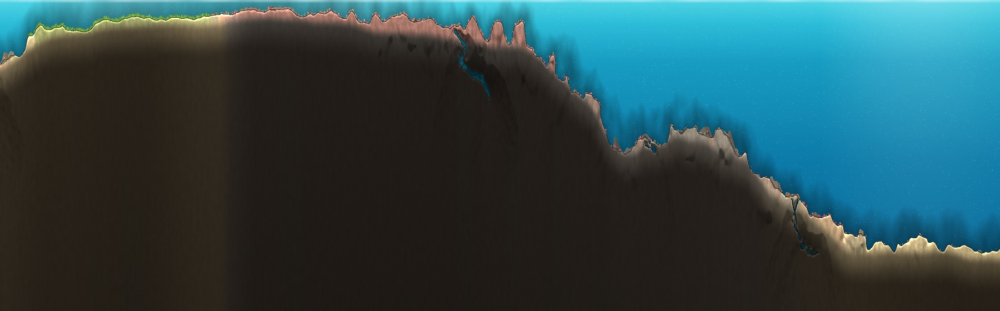
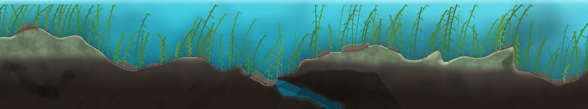
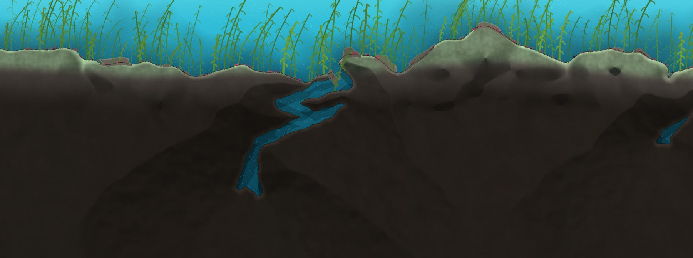
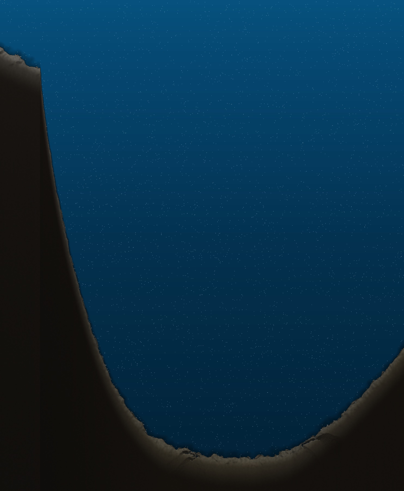
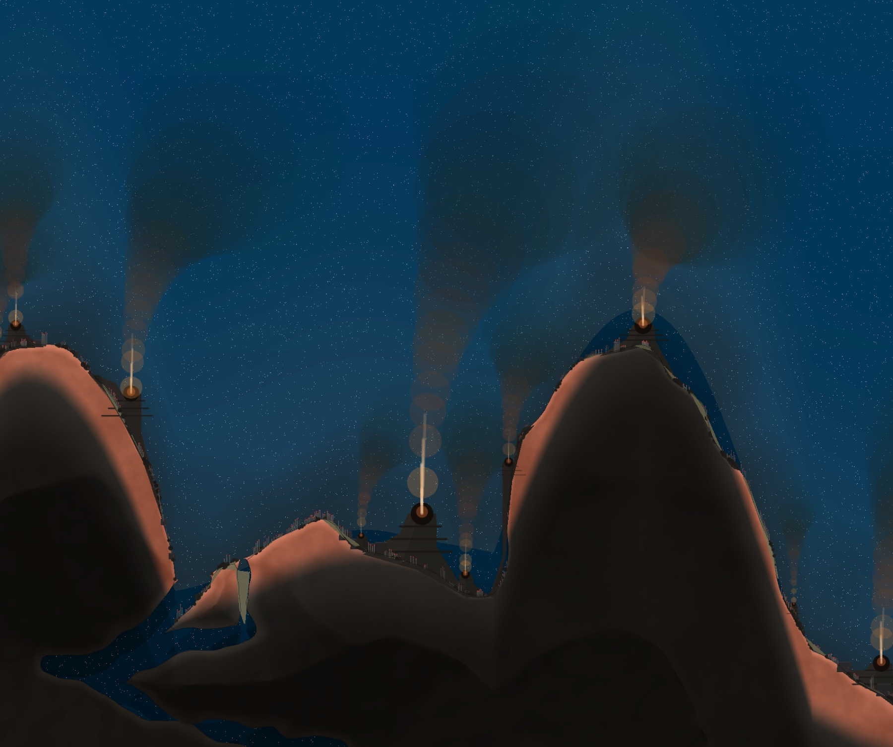
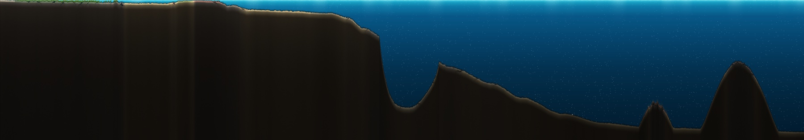

# Ocean Evolution

A 2D side-profile ocean: an open world of kelp forests, coral reefs, submarine
canyons and abyssal vent fields, intended to grow into an evolution and
ecosystem game in which the player starts as one small organism among thousands.

This repository is at **Phase 1.5 of 8**: the world, its vegetation, its caves
and its water, and a camera to look at them with. There are no creatures, no
food web and no evolution yet.



```bash
npm install
npm run dev     # http://127.0.0.1:8040  -- fly through the world
npm run map     # render out/map.html and eleven PNGs of the generated world
npm run check   # determinism, world invariants, typecheck
```

**The URL is a permalink.** It carries `x`, `y`, `z` and `seed`, updated a few
times a second, so any spot in the ocean is a link you can bookmark or send.
Pasting a link into an already-open tab moves the camera rather than reloading.

---

## The biomes, from one seed

Every image below is the same world, rendered by `npm run map` from a single
seed. Biome boundaries are not placed; they fall out of depth, light, substrate
and distance from shore.

<table>
<tr>
<td width="33%" align="center"><br><sub><b>Kelp forest</b></sub></td>
<td width="33%" align="center"><br><sub><b>Rocky caves</b></sub></td>
<td width="33%" align="center"><br><sub><b>Submarine canyon</b></sub></td>
</tr>
</table>

<table>
<tr>
<td width="50%" align="center"><br><sub><b>Abyssal vent field</b> — the only biome whose productivity does not depend on light</sub></td>
<td width="50%" align="center"><br><sub><b>The whole world</b> at map scale</sub></td>
</tr>
</table>

## The one architectural decision

`packages/sim` is the authoritative simulation. It must never import a renderer,
touch the DOM, or call `Math.random` / `Date.now` / `performance.now`
(`npm run check:determinism` enforces this). `packages/game` renders it.

This matters more than it looks. The hardest requirement in the design brief is
that *the ecosystem keeps functioning without the player*, and that is not a
property you can verify by playing. You verify it by running the simulation
headless for fifty simulated years at ten thousand times real time and plotting
the population curves. Keeping the sim free of the renderer and seeded from one
value is what makes that run possible, repeatable, and cheap. Retrofitting
determinism later is miserable, so it is here from the first commit.

The same discipline means the live game, the offline map renderer and any future
balancing harness all construct the identical `World` object.

## Layout

```
packages/sim/          authoritative, deterministic, no DOM
  core/   math, rng, noise, clock       (clock drives tiered update rates)
  world/  profile, terrain, env, biome, flora, palette, marching, world
packages/game/         PixiJS renderer and the free camera
tools/map/             offline map renderer -> out/*.png + out/map.html
tools/screenshot.mjs   drives the live app in a browser and captures a frame
```

## How the world is built

**Nothing is placed.** The world is authored as *geography* and habitats are
derived from it, the same way they are decided in the real ocean.

1. **`profile.ts`** holds the macro cross-section: about thirty `(distance,
   depth)` control points from the shoreline to the abyssal plain, a matching
   substrate-hardness curve, and a handful of constructional features (Mirador
   Canyon, Varu Seamount, the vent ridge, shelf pinnacles). Edit these points to
   redesign the world; everything downstream follows. It also carries the
   sea-surface temperature gradient — cold upwelling in the west, tropical in the
   east — which is the single reason kelp grows inshore and coral grows on the
   bank four kilometres out. Neither is placed.

2. **`terrain.ts`** turns that into a signed density field: `density(x,y) > 0` is
   rock. An implicit field rather than a heightmap, because the brief wants
   caves, tunnels and overhangs and a heightmap cannot express any of them.
   Ridged noise carves the caves, which is what makes them connected tunnels
   instead of isolated pockets. Collision is two cheap samples: value for
   penetration depth, gradient for the push-out direction.

3. **`env.ts`** is the Layer-0 field stack: light, temperature, pressure,
   oxygen (including a midwater minimum zone), nutrients, current, and plankton
   density. Currently analytic functions of position. Phase 2 replaces plankton
   and nutrients with a real advection–diffusion grid stepped by the clock;
   because every reader goes through `sampleEnv`, that swap touches no call site.

4. **`biome.ts`** classifies a point from depth, substrate, slope, light and
   temperature. Because the inputs vary continuously, the outputs blend and
   neighbour correctly by construction — reef gives way to sand because the bank
   slopes into sand, not because anyone drew a boundary there.

5. **`flora.ts`** and **`scatter.ts`** derive vegetation and loose rock from
   position rather than spawning them: 26 species of flora in mixed habitat
   communities, and 7 kinds of boulder, rubble, outcrop and set-piece. Ask
   "what grows between x=1200 and x=1400?" and you get the same answer every
   time, from either direction, on any machine. A twenty-kilometre world gets
   dense vegetation with zero world state.

   Each species is planted on one global grid at its finest spacing anywhere in
   the world, then thinned per habitat. The grid index derives from absolute x,
   so an instance's existence cannot depend on the window it was queried with --
   and a species living in two habitats keeps one stable grid, so crossing a
   boundary thins the population rather than resampling it.

6. **`caves.ts`** builds cave networks as an explicit graph -- chambers for
   nodes, passages for edges, at least one mouth breaking the seabed -- and
   subtracts them from the density field as a true distance. Carving caves by
   thresholding noise instead produced voids that were measurably *sealed*
   (5-47% connected to open water, 7-15 m deep), and in a side view a sealed
   void can never be entered at all. The graph makes the things that matter
   into parameters: every network reaches the water by construction, and
   passage width is chosen from creature-sized classes --

   | class | radius | who fits |
   |---|---|---|
   | crevice | 0.35-0.75 m | sardine, shrimp, goby |
   | tunnel | 1.1-2.4 m | mackerel, small squid, octopus |
   | gallery | 3.0-7.5 m | grouper, shark, anything large |

   That gap is the point. A refuge a small fish fits into and its pursuer does
   not is a survival mechanic, which is more than scenery can be. Measured now:
   **100% connected, 34-83 m deep, median clearance 1.3-3.3 m.** Re-check with
   `npx tsx tools/analyze-caves.ts`.

7. **`floraDraw.ts`** holds the nine body forms (stipe, blade, clump, branch,
   fan, barrel, tube, mat, ball) as geometry emitted to a sink. The live
   renderer and the offline map raster both consume it, so the forms exist once
   instead of drifting apart in two implementations.

## Water you can see

Three things make the ocean read as water rather than a blue background, and
all three come off field data that already existed:

- **Flora bends downstream.** Each instance stores the current at its own
  position and leans with it, swaying harder in faster water. The current field
  had been driving nothing visible at all, which is most of why a still ocean
  looked still.
- **Particulate streaks along the flow** instead of drifting as round dots, so
  the field is legible at a glance: surface drift, the return flow at depth,
  shear near the bed, the upwelling at the west end. `C` draws the raw vectors.
- **Visibility is modelled, not faked.** Two independent limits pull opposite
  ways down the water column: murk (plankton scatters light) and darkness.
  Productive shallow water is bright but soupy, about 60-70 m; the abyss is
  pin-clear and pitch black, about 30 m. A single "darker with depth" curve
  cannot express that, and the difference is exactly what makes the two places
  feel unlike each other. `V` toggles the haze; it fades out as you zoom out,
  because 30 m of visibility across a 666 m survey view is physically honest
  and completely useless.

Sea pens, crinoids and bacterial mats are bioluminescent, and glow only where
there is no sunlight to drown them out.

## Almost none of the plant life is edible

This is the ecologically honest answer and it is also the better game answer.
About 95% of the primary production that anything in the ocean eats is
phytoplankton. Living kelp is grazed by almost nothing -- kelp forests feed the
sea by *shedding* detritus. Seagrass is grazed, but most of that pressure lands
on the epiphyte film on the blades rather than the blades. Coral and sponges are
animals, eaten by a handful of specialists.

So every species carries five numbers, not one:

| field | meaning |
|---|---|
| `edible` | direct food value. Zero for most things here. |
| `epiphyte` | the regenerating grazeable film on its surface. This is what Tier-1 grazers actually live on. |
| `detritus` | what it sheds into the water column, feeding the plankton and detritus fields downstream |
| `shelter` | cover for small creatures -- why flora matters when it is not food |
| `currentDamping` | how much it slows the local flow |

Of 26 species, three are meaningfully edible (seagrass, sea lettuce, algal turf)
and all three are deliberately low-calorie: a survival fallback, never a
strategy. The real link is the fourth one. Kelp and seagrass beds are high-
detritus, and Phase 2 feeds that into the plankton field, so a sardine in a kelp
forest eats well *because of* the kelp without ever biting one. Currents then
carry that detritus downslope, which is how Mirador Canyon gets fed by a kelp
forest 10 km away.

## The map renderer is a debugger

`npm run map` writes `out/map.html` with nine views in three modes:

- **natural** — the ocean as it looks.
- **biome** — flat classification colours, for verifying `biome.ts` by eye.
- **plankton** — the Layer-0 food field.

It also probes a transect and prints a **biome coverage census**: a habitat that
is defined but never actually produced is a bug. That check earned its keep on
its first run by reporting `seagrass_meadow MISSING` — there was nowhere in the
world that was both shallow and sandy, which is why the reef bank now has a
back-reef lagoon behind its crest.

Changing a control point in `profile.ts` and re-rendering takes about thirty
seconds. That loop, not the game, is how the world gets designed.

`npm run check:world` holds the invariants that break *silently* -- where
nothing throws and the world just quietly stops meaning what it is supposed to
mean. Every one of them has caught a real bug:

- **content is window-independent** -- habitat runs clipped to the query range
  meant asking for `[13000,13500]` and `[0,20000]` produced different plants in
  the same place, and let a whale fall on a 2.6 km grid land a kilometre outside
  the abyssal plain that authorised it.
- **every biome occurs** -- caught `seagrass_meadow` having nowhere shallow and
  sandy, which is why the reef bank has a lagoon.
- **nothing grows above the waterline** -- the water-column cap applied only to
  kelp stipes, so surfgrass in 0.6 m of water poked into the sky.
- **every species occurs** -- a species defined but never produced is dead data.
- **nothing is rooted off the rock** — multi-part bodies (boulder bases, basalt
  clusters, tube-worm colonies, grass tufts) used to place every part at the
  root's y, so on a slope the outer parts hung in open water with no bottom.
  Every instance now carries a short profile of the rock under its own
  footprint, and the check verifies that profile against the terrain.
- **every cave opens to the water**, stays within its depth budget, and all
  three passage classes occur.
- **same seed, same world.**

A bug those checks did *not* catch, and the reason they now cover more: each
species' random stream was salted by an incrementing counter assigned in
declaration order. Adding vent chimneys renumbered every kind after them,
silently relocating every boulder in the world and deleting both whale falls.
Salts are derived from the species *name* now, so adding a species never moves
the others.

## Controls

`WASD` swim · `shift` sprint · mouse wheel or `Q`/`E` zoom · `1`–`9` jump to a
named feature (and frame it) · `0` cycles the deep features · `G` habitat tint ·
`C` current field · `V` haze.
The HUD reads out live environmental values at the camera; the strip at the foot
of the screen is the whole twenty-kilometre cross-section with your position.

Zoom runs from 0.55 to 30 px/m. At the close end a 1600 px viewport is 53 m
wide, which is roughly the scale a small fish lives at and the scale at which
sponges, sea fans and urchins read as objects rather than specks. Terrain column
resolution and chunk size follow the zoom on discrete rungs (`LODS` in
`terrainView.ts`), because strips interpolate between sampled columns and a 1 m
step that is invisible at 3 px/m is 30 px of flat facet at 30 px/m.

## Where this goes next

Following the brief's phase order:

- **Phase 2 — food.** Promote plankton and nutrients from analytic functions to a
  real advection–diffusion grid on the clock's field tier. Visible particles are
  spawned *from* local density near the camera; feeding decrements that density.
  Invisible is not nonexistent.
- **Phase 3 — AI wildlife.** Three genuinely different behaviour profiles
  (schooling, territorial, hunter) rather than six shallow ones.
- **Phase 4 — ecosystem.** The regional cohort layer, and the promote/demote
  boundary between cohorts and individuals. That boundary is the riskiest code in
  the project: get it wrong and biomass leaks or duplicates invisibly until the
  whole ecosystem drifts. It needs an invariant test — *total biomass is
  conserved across any promote/demote cycle* — written at the same time as the
  code.
- **Phase 5 — evolution.** Species as data, with diet expressed as a prey-size
  window plus taxon affinities so the overlapping food web is computed rather
  than hand-maintained. Adding a species must never require editing another one.

Before the ecosystem goes live it needs a believable starting state. Run the
regional layer headless from a rough guess for ~50 simulated years until it
settles, then ship that snapshot — so the ocean opens in equilibrium instead of
lurching toward it while the player watches.

## Known rough edges

- `TerrainView` rebuilds every chunk after a large vertical camera move. Fine for
  a free camera, wrong for a creature that swims up and down a canyon wall.
- The camera's zoom range suits a world viewer. A 15 cm sardine will want to be
  much further in, and the terrain column step will need to follow it.
- Flora redraws at ~36 Hz for sway. Rigid species (coral, sponges, urchins)
  could be baked into the cached terrain chunks like scatter and never redrawn.
- Vent plumes are drawn as overlapping translucent discs. They read well in
  motion but the individual circles are visible close to the orifice.
- Deep close-ups in the map are rendered with the exposure pushed, because the
  abyss really is almost black. The game does not do this, and will eventually
  need a real answer for deep-sea visibility (bioluminescence, limited draw
  distance) rather than just dark water.

## Rendering notes, learned the hard way

- `app.screen.width` is the logical viewport. `renderer.width` is *also* already
  logical, so dividing it by `resolution` halves everything on a Retina display
  -- and is invisible at DPR 1, which is what the screenshot harness defaulted
  to. The harness now captures at DPR 2.
- Rock is drawn as trapezoid strips between adjacent columns, not flat-topped
  rectangles, or every surface gets a staircase.
- Shade by depth *into the span*, not by where the span starts, or a cave
  shifting a span's start draws a hard-edged vertical bar down the whole screen.
- Mottling must be sampled in two dimensions. A per-column hash reads as
  vertical stripes, not texture.
- Depth fade darkens colour; it must never reduce alpha. Fading by alpha made
  deep sponges see-through and double-blended wherever a body overlapped itself.
- A chunk's vertical build margin must scale with the viewport. A flat ±400 m
  margin meant that at 11 px/m each column sampled an 880 m span at 0.25 m
  resolution — about 2.7 million density evaluations before the first frame
  could draw, which presented as a hang with no error in the console.
- Anything emitted from a source must have zero offset *at* the source. The vent
  plume's drift had a constant term, so the smoke column was born beside the
  chimney instead of out of it.
- Subtract geometry as a true distance, not a smooth falloff. Carving caves
  with a smoothstep term destroyed the signed-distance property of the whole
  field: the middle of a 1.5 m tunnel reported 200 m of clearance, which would
  have told collision there was nothing near the fish.
- Anything with a bounding box needs padding beyond where its influence ends,
  or the cutoff draws a literal rectangle. The cave boxes are padded 86 m and
  the influence is faded over the last 20 m.
- Shade geology from the SEABED, not from the nearest surface of any kind.
  Using raw density meant the rock around a cave was lit like sunlit crust for
  20 m in every direction -- a glowing halo around a pitch-dark interior.
- Caves are water, so nothing is drawn there and the open-ocean backdrop shows
  through, which makes every overhang look like an island floating in the sea.
  Enclosed voids are filled as unlit flooded space in their own pass.
- A highlight along a surface must be weighted by how much that surface faces
  the light. Stroking every column-to-column step drew bright vertical wires
  down the cliff faces at cave mouths.
- Stacked translucent discs accumulate alpha at the CENTRE. A radial gradient
  that darkens outward needs annuli (thick stroked circles), not filled discs.
- Headless Chrome caps requestAnimationFrame at 30 fps — a blank page measures
  30 — so `tools/screenshot.mjs` passes `--disable-frame-rate-limit`. Without it
  every frame-rate reading from the harness is the cap, not the renderer.
